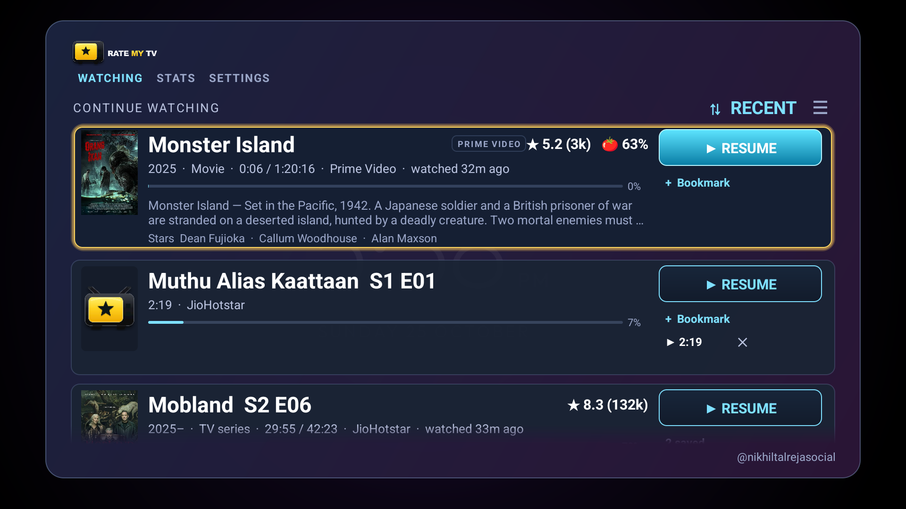
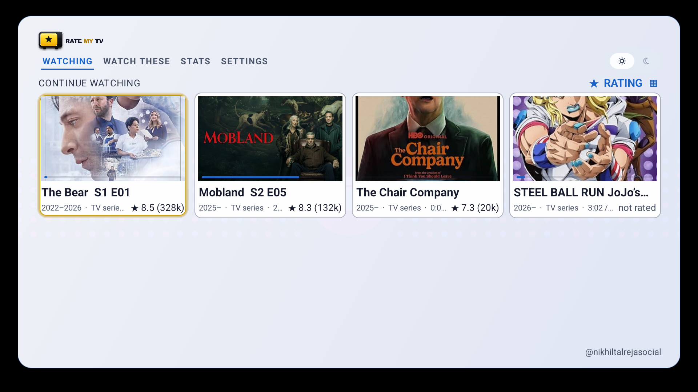
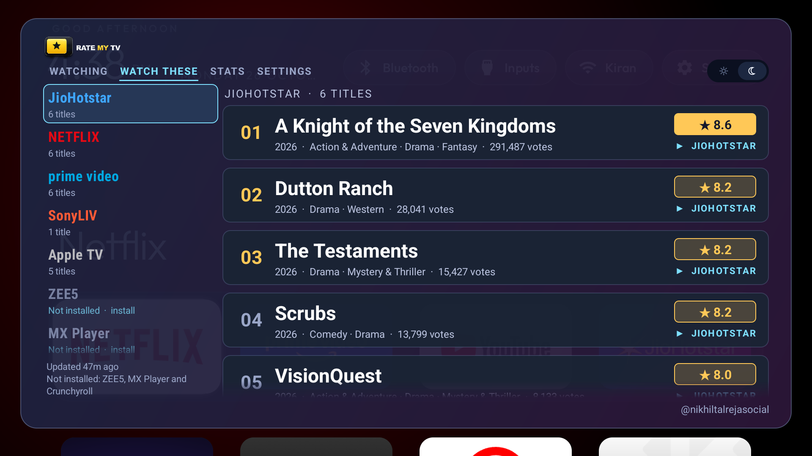
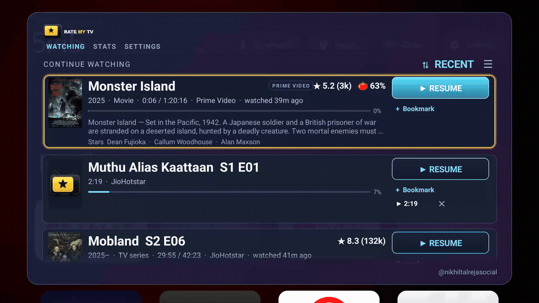
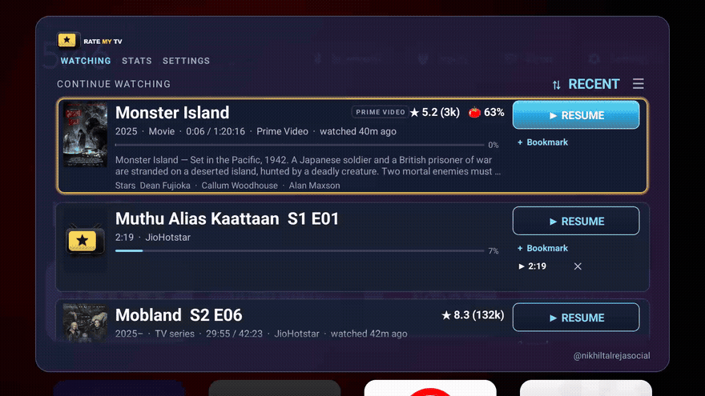
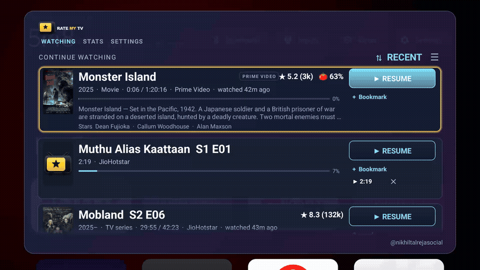
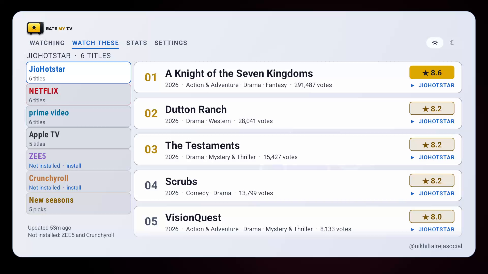

<p align="center">
  
</p>

<p align="center">
  <picture>
    <source media="(prefers-color-scheme: dark)" srcset="docs/brand/rate-my-tv-logo-v2.png">
    
  </picture>
</p>

**X-Ray for JioHotstar.** One button on the remote, and a card opens over whatever is
playing: what this TV has watched, IMDb and Rotten Tomatoes scores, plot and cast, and
a way back into any title.

Prime Video ships X-Ray. JioHotstar never got one. That is the app this is built for.
YouTube, Netflix, Prime, Apple TV and SonyLIV work too, where their own data allows,
and the section below says exactly where that stops.

Then it goes one step ahead of X-Ray. **Watch These** is a rolling list of the
best-rated shows streaming on the services installed on this TV — JioHotstar, Netflix,
Prime Video, ZEE5, Apple TV, Hoichoi and Crunchyroll, one service per section
per installed app. It is rebuilt from the ratings catalogue every 12 hours. OK on a
pick opens the title in its app, with no search.

<p align="center">
  <a href="#what-it-does">What it does</a> ·
  <a href="#install">Install</a> ·
  <a href="#one-button-while-watching">Remote button</a> ·
  <a href="#app-support">App support</a> ·
  <a href="#screenshots">Screenshots</a> ·
  <a href="#bookmarks">Bookmarks</a> ·
  <a href="#troubleshooting">Troubleshooting</a> ·
  <a href="#build">Build</a>
</p>

## What it does

- **Ratings on demand.** IMDb score and votes, Rotten Tomatoes, plot, cast and year —
  for a JioHotstar title, in about a second.
- **One step ahead of X-Ray.** **Watch These** lists the best-rated 2026 shows across
  the seven services it covers, one section per installed app, refreshed every 12 hours.
  OK opens the title in its app.
- **Continue watching.** One list from this TV's own playback record, across apps,
  with progress and elapsed time.
- **Instant switching** (`ALT+TAB` on a keyboard, `RESUME` on a remote). Jump from one
  title to another without going home first, including JioHotstar to YouTube and back.
- **Bookmarks.** Up to two saved positions per title, each one press away.
- **Stats.** Titles this month, average IMDb score, how many above and below 6.0,
  total history.
- **Names shows itself.** JioHotstar's stream URLs carry only numeric ids; the app
  resolves the show name from JioHotstar's public sitemap, so a row reads
  *Koffee with Karan S9 E02* rather than an episode label.

## Install

Rate My TV is **not on the Play Store**. It installs the way Kodi does: one APK,
sideloaded with Downloader, then updated from inside the app. No computer, no cable.

| | Google TV / Android TV | Fire TV |
|---|---|---|
| **1. Downloader** | Your TV's app store → search **Downloader** → Install | Amazon Appstore → search **Downloader** → Install |
| **2. Allow installs** | Settings → Apps → Security & restrictions → Install unknown apps → **Downloader** → On. Or say yes when it asks. | Settings → My Fire TV → About → press Select 7× → Developer Options → Install unknown apps → **Downloader** → On |
| **3. Address** | Open Downloader, type **is.gd/ratemytv**, Go | Same |
| **4. Install** | It saves `ratemytv.apk` (about 320 KB). Choose **Install**. | Same |
| **5. Allow** | Settings → Apps → Special app access → **Display over other apps** → Rate My TV → On. Then **Notification access** → Rate My TV → On. | Same |
| **6. Open** | Rate My TV is in the apps row. Open it. | Same |

The only thing from a store is Downloader (Play Store on Google TV, Amazon Appstore on
Fire TV). The app itself is the sideloaded APK. The address is a redirect to the newest
GitHub release; the long form is
[releases/latest](https://github.com/nikhiltalreja/ratemytv/releases/latest).

Step 5 is what the card needs: the first switch lets it draw over the player, the
second lets it read the title that is playing. The TV's own watch-next rows are
optional: they import the history from before install. Without that grant, Rate My TV
remembers what it sees from now on. The ADB block below has it.

Ratings need a free [OMDb key](https://www.omdbapi.com/apikey.aspx), pasted into
Settings on first run. Without one the card still opens and shows what the public
catalogue knows; the rest reads **not rated**.

<details>
<summary><strong>Install with ADB instead</strong></summary>

Android 7 (SDK 24) or newer, no root. If ADB is already listening — a Fire TV with ADB
debugging on, or a TV you connected before — skip `adb connect` and install straight
away.

```bash
adb devices                 # is the TV already listed?
adb connect <TV_IP>:5555    # only if it is not
adb install -r ratemytv.apk
adb shell pm grant dev.ratemytv android.permission.READ_TV_LISTINGS
adb shell appops set dev.ratemytv SYSTEM_ALERT_WINDOW allow
adb shell cmd notification allow_listener dev.ratemytv/dev.ratemytv.Watcher
adb shell appops set dev.ratemytv REQUEST_INSTALL_PACKAGES allow
```

Fire TV listens on 5555 once **ADB debugging** is on, with no pairing code. Google TV
on Android 11+ may ask for `adb pair <TV_IP>:<pair_port>` first. If 5555 is held by a
stale session, `adb disconnect` and retry. Turn ADB off when done; the app does not
need it.

</details>

### Updating

The app checks GitHub for a newer release when the card opens (and re-checks every two
hours). When one exists, a banner offers **Install**, which downloads the APK and opens
Android's own installer. Same signing key, so the update keeps your history and
bookmarks.

## One button while watching

Rate My TV has no remote-key settings of its own. To open the card from the couch, give
one button to a TV key mapper. **Button Mapper is the free one**; **tvQuickActions Pro**
is paid, and is the one that explicitly supports the Netflix button on Xiaomi TVs.

| | **Button Mapper** | **tvQuickActions Pro** |
|---|---|---|
| Price | Free to install; launching an app is in the free version | **$3.99**; a free version exists, but Xiaomi Netflix support is Pro |
| Xiaomi Netflix button | Try it; may not see a key the firmware consumes | Explicitly supported |
| Long press | Yes | Yes |
| Made for | Phones first, remaps TV remotes | Android TV / Google TV |

### Button Mapper (free)

1. Install [Button Mapper](https://play.google.com/store/apps/details?id=flar2.homebutton)
   and allow its accessibility service.
2. Add the remote button, set its **long press** to launch **Rate My TV**, and leave the
   single press alone.
3. Its UI is made for phones, so the D-pad can be fiddly; a mouse helps. If the TV's
   Play Store does not list it, use tvQuickActions Pro below.

Launching an app is free; the paid Pro adds intents, scripts and themes.

### tvQuickActions Pro (paid, only if the Netflix key resists)

1. Install [tvQuickActions Pro](https://play.google.com/store/apps/details?id=dev.vodik7.tvquickactions)
   ($3.99). Its listing says it explicitly supports the Xiaomi Netflix button; the free
   version does not list that support.
2. Allow its **Accessibility service**.
3. Add the Netflix button, set its **long press** to open **Rate My TV**, and leave the
   single press alone.
4. Save. While watching, hold the button: the card opens over the player.

Launching an app needs no root and no ADB in either app. Only one accessibility service
can take a key: if Rate My TV's own accessibility service is already on, turn it off
before using a mapper. Fire TV has no Play Store; use the mapper from the Amazon
Appstore if it is there, or sideload its APK.

## App support

JioHotstar is the target and the only app where everything works without caveats.
The rest are supported as far as their own data allows, measured on a Xiaomi Mi TV.
Method and timings: [docs/PROVIDERS.md](docs/PROVIDERS.md).

| App | Live title | History and resume | Notes |
|---|---|---|---|
| **JioHotstar** | Yes, immediately | Yes | Full support: exact rows, name resolution, deep links, seeking |
| YouTube | Yes, immediately | Yes | No ratings; opens a search for the title |
| Apple TV | After playback stops, ~16 s | Yes | Writes its row when the player closes |
| Netflix | No | Yes, 6–10 min after leaving the app | No metadata while playing; rows are backdated |
| Prime Video | Unmeasured | Yes | Ships its own X-Ray, so this adds little |
| SonyLIV, Airtel Xstream | No | Rows only | No live titles, no deep links |

What this means in practice: on JioHotstar the card knows what is playing, what it is
called, and where you are. On YouTube it knows the title but nothing worth rating. On
Netflix and Apple TV it cannot identify a title until its row appears, minutes later —
so a first-time watch stays invisible while it plays. Those gaps are properties of the
apps, not of this one.

## Screenshots

On a Mi TV at 1080p:

| Watching | Grid | Watch These |
|---|---|---|
|  |  |  |

Capture steps and the full six-screen set: [docs/SCREENSHOTS.md](docs/SCREENSHOTS.md).

## Feature demos


A two-slide overview, built from the card's own still: what is playing, then the card
over it, with The Bear's IMDb score in focus.

Recorded on the TV itself. JioHotstar in front, remote only.

### Ratings



Open the card while anything plays: title, season and episode, IMDb score with vote
count, Rotten Tomatoes, plot, cast, progress. One second, cached afterwards.

### Instant switching (ALT+TAB)



Move down the list and press OK: the playing title is replaced by the chosen one,
without visiting the home screen. With a keyboard, `ALT+TAB` opens the same card.

### Bookmark a scene



`Right` to `+ Bookmark`, press OK: the live player position is saved and appears as a
time pill. The pill reopens the title and seeks to that second; the cross deletes it.
Two per title.

### Cross-app switching and stats

Being recorded next. Both use the same gesture as above: cross-app switching is a row
from another app, and stats is the `STATS` tab.

## Permissions

| Permission | Purpose | If missing |
|---|---|---|
| `READ_TV_LISTINGS` | Import the TV Provider's watch-next rows from before install | History starts at install; the app still records what it sees |
| `SYSTEM_ALERT_WINDOW` | Draw the card over another app | No card |
| Notification listener | `MediaSession` metadata and playback position | No live title; the app still records history |
| `INTERNET` | Rating lookups, sitemap names, release check | No ratings, no names, no updates |
| `REQUEST_INSTALL_PACKAGES` | Hand a downloaded APK to the installer | Update banner cannot install |

## Using the card

`WATCHING` lists titles this TV has played. `WATCH THESE` is two panes: the services
installed on this TV on the left, the selected service's 2026 picks on the right.
`STATS` summarises the month. `SETTINGS` holds the OMDb key, the theme, and the version
(with the update state). Colour, type and focus rules live in [docs/UI.md](docs/UI.md).

| Key | Action |
|---|---|
| Up / Down | Previous / next title |
| Up (on the top row) | Move to the tab bar |
| Left / Right (on a tab) | Previous / next tab |
| Right, Left | Cycle the focused row's actions: `RESUME`, `+ Bookmark`, then each saved scene and its delete |
| OK | Activate the highlighted action |
| Back | Close the card |
| Right (menu open) | Close the flyout — it comes in from the left edge, so right puts it back |

In `WATCH THESE` a key never means two things — the pane with focus decides:

| Focus | Up / Down | Left / Right | OK |
|---|---|---|---|
| Service rail (left) | Previous / next service | Right enters that service's page | Open the page |
| Collection (right) | Previous / next title | Left returns to the rail | Open the title in its app |

Only the focused row draws `RESUME` in the accent colour; the rest stay dark, so the
active control is unambiguous.

Row titles are **one size, 20sp, in both tabs** — down 17% from the original 24 in
`WATCHING` and 13% from 23 in `WATCH THESE`. They were briefly 21 and 20: two numbers
that happened to round to the same cap height on this panel but still read as a mismatch.
Both now come from `TITLE_SP`, so they cannot drift apart again. At ten feet the title
still sets at ~1.5× the meta line and stays the first thing read, but long rows like
*A Knight of the Seven Kingdoms* stop crowding the score badge and the actions. The grid's
card titles were already smaller and are unchanged.

### Light mode is not a website

A TV is watched from three metres, so "secondary" has to mean *smaller*, not *fainter*:

- Secondary greys are much darker on the light card (`#2C3549` and `#4A5468` instead of
  `#3E4A66`/`#6A7590`), taking them from roughly 3:1 to 7:1 and 5:1.
- **Letter-spacing is near-flat on labels** — `NEW SEASONS · 5 PICKS` and the section
  headers were tracked at 0.10–0.22em, which on a light card with grey text turned into
  a row of separated hairlines. Titles keep their tighter setting; labels now sit at
  0.03–0.06em.
- Brand inks have a **light-mode variant**: Apple TV drops to near-black (`#2F3238`)
  because its dark-mode near-white vanished, Netflix deepens to `#C40812`, and the
  "not installed" tiles keep their own colour at higher alpha rather than going grey.
- The score badge splits into two golds: a bright fill with dark text for 8.5+, and a
  darker ink (`#7A5200`) for the outlined 8.0+ badge, which was gold-on-white at 3.4:1.



### Bookmarks

Bookmarks store the **live player position** at the moment you press, not the stale
record, and they are keyed to the title rather than the episode — so a new episode of
the same show still finds them. Two per title is a deliberate cap: a third pushed the
row taller than its poster.

Seeking waits for the player to actually start, then verifies the position and seeks
again if the app reset it. Apps without transport controls ignore the seek; the title
still opens.

### Sorting

`⇅` switches between most recently watched and highest rated. While something is
playing the list is always by recency, with that title pinned first.

### Watch These

Series that began in 2026, each above 7.0 on IMDb, on any of **seven services**: JioHotstar,
Netflix, Prime Video, ZEE5, Apple TV, Hoichoi and Crunchyroll. The list
is fetched live on the TV from one public, keyless ratings catalogue the card also uses to
fill scores OMDb lacks. Three requests of 100 shows each carry title, year, three genres,
the IMDb score and vote count, and the offers — which service carries it and its canonical
URL. About **175 KB**, still with no poster, plot or cast.

Each title is placed on the first service, in that order, that carries it, so nothing is
listed twice. Rating must be strictly above 7.0 with at least 1 000 votes; the result is
sorted by rating then votes and **capped at six per service** — Netflix alone had 36
qualifying series, which is a catalogue, not a shortlist. About 25 rows on the test TV.

The panel is **two panes**: a rail of services on the left — a wide wordmark in each
brand's own colour, with its count — and one service's collection on the right. The rail
remembers the last service you opened. The selected service's name and count
(`NETFLIX · 6 TITLES`) sit on their own line above both panes, not inside the collection:
a heading in the pane pushed its first title down and left it a few pixels below the
first rail tile. Now the two columns start on the same line.

A service whose app this TV cannot open stays in the rail, dimmed, labelled
**"Not installed · install"**, and its page shows the same picks with an `INSTALL` action:
OK opens the Play Store listing, so a missing service is one press from being added.
`NEW SEASONS` is the last tile — the hand-checked row from below, kept out of the live
pages because it is curated, not fetched.

"Installed" means **launchable**, not merely present. This TV ships preloads that look
installed: SonyLIV is a real app with a leanback launcher, while MX Player is a disabled
stub (`enabled=3`). Both were removed from the rail on request; the lesson stands, and an
existence check would still have counted the disabled one as available.

Links name their app, and use the service's own **Android TV intent** when the catalogue
publishes one. JustWatch exposes `deeplinkURL(platform: ANDROID_TV)` per offer, and it is
exactly what a TV needs:

```
intent://www.netflix.com/watch/82116553#Intent;launchFlags=0x00800000;
scheme=https;package=com.netflix.ninja;S.source=30;end
```

Note `/watch/<id>` — it starts playback, not just the details page — and the package and
launch flags ride along, so no browser can win the link. The card stores that string and
launches it with `Intent.parseUri(..., URI_INTENT_SCHEME)`. When an offer has no TV
deeplink, it falls back to the web URL with the package set explicitly.

Before that, the plain `https://www.netflix.com/title/<id>` was handed to the system with
no package: a browser also claims `https` and won, and even with the package pinned the
app only came to the front at Home. The `nflx://` scheme was tried in between; it is not
better.

Remaining caveat, and it is Netflix's: on a cold start with no profile chosen, the profile
picker can swallow the incoming link. The link is delivered — `dumpsys` shows it on
`com.netflix.ninja/.MainActivity` — but what Netflix does after profile selection is its
own decision, and its screen cannot be observed (FLAG_SECURE blocks screenshots).

The wordmarks are drawn as type. A real logo would have to be a bundled asset — there is
no trustworthy, licence-clean source a TV can fetch at runtime, and a scraped mark that
sits wrong looks worse than clean type. Drop an official PNG at
`app/assets/logos/<key>.png` — `netflix.png`, `prime-video.png`, `jiohotstar.png`,
`apple-tv.png`, `zee5.png`, `hoichoi.png`, `crunchyroll.png`, `new.png` — and the rail
uses it instead, no code change: the loader checks that path first.

Each tile sits on a **dark scrim plate** with a hairline in the service's colour. Without
it the saturated marks bloomed against the purple card — Netflix red worst of all — while
the dull ones read as dead buttons. Brand inks are tuned for a dark card rather than a
white web page: Netflix lifted to `#FF6B6B`, Apple TV to near-white `#E9E9F0` (its slate
grey looked disabled), ZEE5 and Crunchyroll brightened. A service that is not installed
keeps its own colour at reduced alpha, not grey — grey reads as "broken", which is exactly
how Apple TV looked.

Not listed, because the ratings catalogue carries no offers for them in this market, so
there is nothing to join against: **Aha, Sun NXT, ETV Win, ManoramaMAX**. Amazon and Apple
reseller packages ("Prime Video with Ads", "SonyLIV Amazon Channel") are ignored on
purpose — they are the same catalogue through a middleman.

Because the offers carry the link, the panel no longer needs the JioHotstar sitemap: that
624 KB download is gone from this feature, and so is its 24-hour lag.

The list is cached for **12 hours**; after a failed fetch it backs off for 15 minutes.
Opening the tab always paints the cached (or bundled) list first, so nothing waits on the
network, and the panel repaints itself when a refresh lands. On the first run offline it
falls back to five saved picks, labelled as such.

### New seasons, by hand

The live join selects on the series' **original** release year, so a returning show
never qualifies however new its season is. JustWatch reports *House of the Dragon* as
2022 and exposes no season dates and no offers; the one substitute — qualifying on the
Hotstar page's `lastmod` — drags in *Game of Thrones*, *Friends* and *Loki*, whose pages
were merely edited this year.

So a short second row, **NEW SEASONS IN 2026**, is checked by hand: each season's
premiere date confirmed against IMDb episode data through OMDb, its score read from the
same JustWatch feed, its link from the JioHotstar index. The panel says it is hand-
checked, so it never passes as part of the live join.

| Series | Season | IMDb | Votes |
|---|---|---|---|
| The Bear | S5 | 8.5 | 329,129 |
| Jujutsu Kaisen | S3 | 8.5 | 224,926 |
| MobLand | S2 | 8.3 | 136,487 |
| House of the Dragon | S3 | 8.2 | 576,151 |
| Euphoria | S3 | 8.1 | 327,247 |

Checked 26 October 2026. Refresh it the same way: episode dates from OMDb, score from
JustWatch, link from the sitemap.

## Names, ids and deep links

JioHotstar's stream URL carries numbers, not text, and the folder that names the
content type changes between app versions — `v3`, `episode1`, `eptitle01` so far:
`…/videos/hotstarint/<type>/<showId>/<episodeId>/v3/…`. The media session leaks only
the episode label (`S2 E5 Birdland`). So the app:

1. parses **show id and episode id** out of every stream it sees — whatever that
   folder is called, the next two segments are the ids — and keeps both;
2. resolves the **show name** from `www.hotstar.com/in/new-sitemap-SHOWS-1.xml`
   (624 KB, 4 871 shows, id → slug → title case, cached a day, refetched on a miss);
3. plays a title with `https://www.hotstar.com/in/watch/<episodeId>`, which JioHotstar
   claims as an app link and routes to the exact episode;
4. uses the provider's own deeplink when one exists, and refuses to guess when none
   does — see Known issues.

## Troubleshooting

| Symptom | Cause | Fix |
|---|---|---|
| Card opens empty | `READ_TV_LISTINGS` not granted | `adb shell pm grant dev.ratemytv android.permission.READ_TV_LISTINGS` |
| No card at all | Overlay permission missing | `adb shell appops set dev.ratemytv SYSTEM_ALERT_WINDOW allow` |
| Nothing under NOW WATCHING | Listener not enabled | `adb shell cmd notification allow_listener dev.ratemytv/dev.ratemytv.Watcher` |
| Netflix or Apple TV title missing while playing | Those apps publish no metadata | Expected; the row appears after you leave the app |
| Row shows `S9 E2 …` instead of a show name | Show absent from the sitemap and no row of its own | Expected; the episode label is the fallback |
| "not rated" | OMDb has no entry (common for regional titles) | Nothing to fix; the title still plays |
| Update banner does not appear | No release newer than the installed build, or offline | Publish a release; the check runs on card open |
| Install does nothing | "Install unknown apps" not allowed for Rate My TV | Settings → Apps → Rate My TV → Install unknown apps |
| Card opens, then closes immediately | Signature mismatch after installing over a different build | Uninstall, then install again |
| Overlay drawn but no focus | Another accessibility service is grabbing input | Disable it temporarily |

Diagnostics: `adb logcat -s RATEMYTV RATEMYTV_MAP RATEMYTV_UPD` shows the launch path,
the sitemap map, and the release check.

## Limitations

Kept here on purpose: these are the places where help is welcome.

- **Apps that publish nothing cannot be identified live.** Netflix and Apple TV hide
  their titles until they write a row, which can take minutes.
- **Netflix and Prime refuse deep links.** A title opens the app, not the title.
- **Some JioHotstar shows publish no watch-next row.** The episode id still plays them,
  but the row is only as good as the id we parsed.
- **Regional titles are thin in OMDb.** A second source (TMDB) would fix ratings for
  them; it needs one more optional key.
- **No OCR or screen reading.** Secure surfaces make it impossible, and it would be
  fragile anyway.
- **No telemetry, no accounts, no server.** Nothing leaves the TV except rating
  lookups, JioHotstar's sitemap, and a release check.

## Known issues

**A JioHotstar title with no provider row and no id.** The episode id comes from the
stream URL, so a title played on this TV normally has one. A record created before the
id was stored, or through an app that exposes no metadata, cannot be routed: the row
opens JioHotstar's home screen instead of the title. The card says so rather than
playing something else.

**Prime Video and Netflix rows are learned, not observed.** Their positions come from
the TV Provider after you leave the app, so they lag by minutes.

## Build

No Gradle, no Android Studio, no CI. One PowerShell script drives `aapt2`, `javac`,
`d8`, `zip` and `apksigner`:

```powershell
$env:ANDROID_HOME = "C:\path\to\android-sdk"
powershell -File app/build.ps1
```

Releases, including the version bump, checksum, commit and GitHub release:

```powershell
powershell -File app/release.ps1 -Version 1.0.1
```

There is no CI and that is deliberate: hosted runners for this repo failed with no
runner assigned and zero log output, so releases are cut from a machine that has the
SDK and a TV attached.

## Repository layout

```
app/
  AndroidManifest.xml      permissions, overlay service, receiver
  build.ps1, release.ps1   build and release, no Gradle
  src/dev/ratemytv/
    Watcher.java           listener + poller: sessions, provider rows, local history
    OverlayController.java the card: rows, actions, bookmarks, stats, settings
    Ratings.java           OMDb lookups, cache with negative caching
    Catalogue.java         public ratings catalogue: scores and row text OMDb misses
    Sitemap.java           show id -> name, from JioHotstar's public sitemap
    Updater.java           release check, download, installer handoff
    Seek.java              post-launch seek with verification
    Cache.java             poster files
    Bookmarks.java         scenes, two per title
    WatchThese.java        live join: Hotstar index + public ratings, 12 h cache
docs/
  PROVIDERS.md             what each app publishes, measured
  UI.md                    ten-foot UI rules: contrast floors, type scale, both themes
tools/probe/               diagnostic APK: dumps every watch-next row and column
```

## Contributing

Useful contributions, in rough order of value:

1. **Another metadata source** (TMDB) to cover titles OMDb misses.
2. **More provider measurements** — a row in `docs/PROVIDERS.md` with the app, what it
   publishes, and how long it takes.
3. **Deep link formats** for Netflix, Prime, Apple TV, if any exist.
4. **Launcher integration** notes for TV brands other than Xiaomi.

Keep the constraint in mind: no accounts, no server, no telemetry, and no reading the
screen.

## Brand assets

`assets/mark.png`, `logo-light.png`, `logo-dark.png`, `monogram.png`. The mark is 3D;
please do not replace it with a flat redraw.

## Credit

Built by [@nikhiltalrejasocial](https://instagram.com/nikhiltalrejasocial).

## License

MIT. The credit line in the card and on the splash is a condition of use: it must stay
visible in every build.
